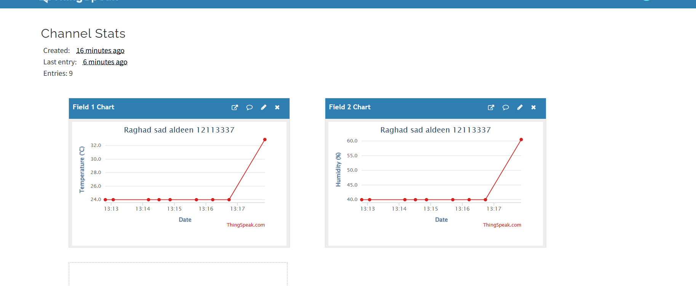
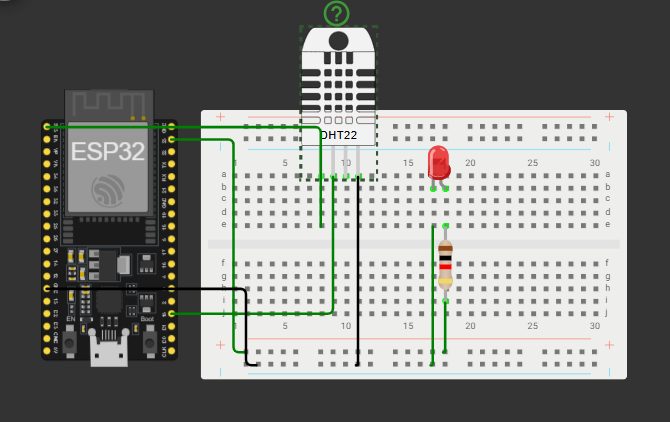

# ESP32 Temperature and Humidity Monitoring

## Student
- Full Name: Raghad Sad Aldeen
- University ID: 12113337

## Project Description
This project uses an ESP32 and a DHT22 sensor in Wokwi to
measure temperature and humidity and send the readings to
ThingSpeak every 30 seconds.

The readings are displayed publicly using ThingSpeak's
built-in charts. An LED turns on when the temperature
exceeds 30°C.

## Project Links
- ThingSpeak: https://thingspeak.mathworks.com/channels/3551401
- Wokwi: https://wokwi.com/projects/478940855652019201

## Components
- ESP32 DevKit
- DHT22 sensor
- Half breadboard
- Red LED
- 1 kΩ resistor
- Jumper wires

## Wiring
| Component Pin | Connection |
|---|---|
| DHT22 VCC | ESP32 3.3V |
| DHT22 DATA (SDA) | ESP32 GPIO 15 |
| DHT22 GND | ESP32 GND |
| DHT22 NC | Not connected |
| LED anode (A) | GPIO 23 through a 1 kΩ resistor |
| LED cathode (C) | GND |

The Wokwi schematic is included in diagram.json.

## ThingSpeak Configuration
- Field 1: Temperature (°C)
- Field 2: Humidity (%)
- Channel visibility: Public

## How to Run
1. Open the Wokwi project linked above.
2. Set writeAPIKey to your ThingSpeak channel's Write API Key.
3. Start the simulation.
4. The ESP32 connects to Wokwi-GUEST Wi-Fi.
5. Check the Serial Monitor for readings, the university ID,
   and successful upload messages.
6. Open the public ThingSpeak channel to view the charts.

The GitHub source uses a placeholder for the Write API Key.

## Verification
Temperature and humidity were changed in Wokwi from
24°C and 40% to 32.9°C and 60.5%. Both ThingSpeak charts
showed the change over time.

The public channel was also opened in an InPrivate window
without signing in.

## Screenshots

